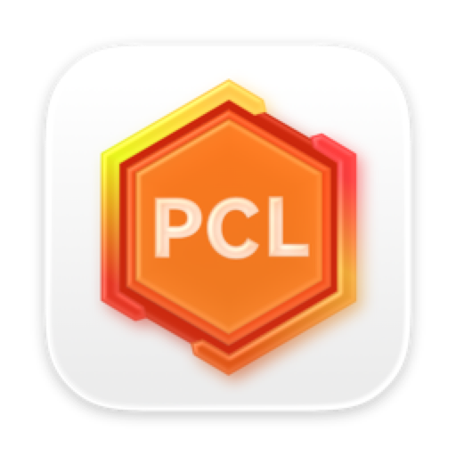
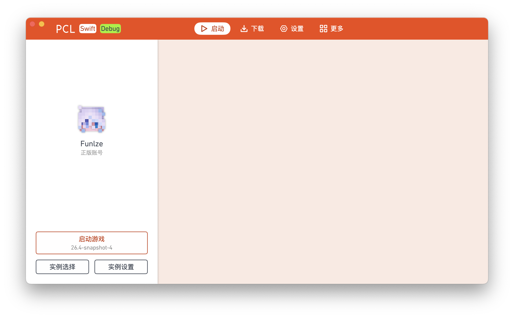
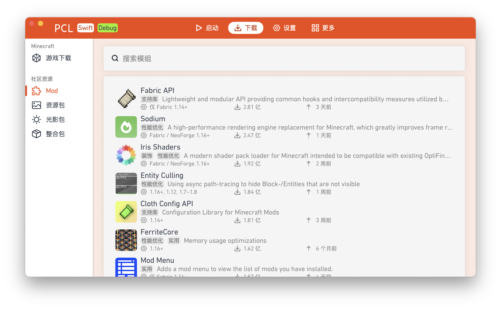

# PCL.Swift

  
  <h1>PCL.Swift</h1>
  
  
  
  

 

PCL.Swift 是 [Plain Craft Launcher](https://github.com/Meloong-Git/PCL)（由 [龙腾猫跃](https://afdian.com/a/LTCat) 制作的 Minecraft 启动器）的**非官方** macOS 重构版，使用 SwiftUI 框架**完全重构**了 PCL 以支持 macOS。

本项目基于 Cylorine Studio 的 [PCL.Mac.Refactor](https://github.com/CylorineStudio/PCL.Mac.Refactor) 1.1.1 独立维护，在其之上做了系统性的功能扩展与体验重做。

<table>
  <tr>
    <td></td>
    <td></td>
  </tr>
</table>

问题反馈：请前往 [Issues](https://github.com/LakelightLily-Studio/PCL.Swift/issues)。

**请不要在 PCL 官方版本 / 其它版本相关仓库或群聊中反馈关于 PCL.Swift 的问题。**

## 相比 PCL.Mac.Refactor 改了什么

下面只列用户能直接感知到的变化——新功能、新特性与优化，不涉及实现方式。

### 首次启动

- **开场动画与设置向导**：第一次打开先播开场动画，接着进入设置向导（欢迎 → 账号 → Java → 主题 → 完成），每一步都能单独跳过。走完向导才算完成首次配置，之后再打开直接进启动器。
- **完成页**：向导结束是一张独立的庆祝页，彩带与「设置完成」居中呈现，不再和配置项挤在一起。

### 外观与个性化

- **主题色**：14 套预设主题，外加「自定义」用色相 / 饱和度 / 明度三个滑杆调基色。整套强调色阶（主色、深浅档、选中底色、窗口底色）随基色联动，文字与灰阶保持中性以维持对比度。
- **深浅色外观**：跟随系统 / 浅色 / 深色三选一。深色不是把浅色调暗，而是重新派生整套色阶，卡片、下拉面板、弹窗、提示条一起适配；选「跟随系统」时会随系统外观实时切换。
- **标题栏**：背景可选纯色 / 线格 / 液态玻璃（Beta）。液态玻璃在 macOS 26 起使用系统材质，更低版本退回原生毛玻璃，不掺主题色；另带一个「模糊程度」滑杆。标识可选默认字标、自定义文本、自定义图片或完全隐藏。
- **背景图片**：可指定单张图片，也可用数据目录 `Pictures/` 里的随机图。支持适配方式、不透明度、模糊与「叠加彩色背景」开关；指定图片打不开时会自动解绑并退回随机图，背景不会静默消失。

### 主页

- **四种主页类型**：空白 / 预设 / 本地 XAML / 远程 XAML。本地与远程都直接读 PCL2 的 `Custom.xaml`，已有主页可以直接沿用。
- **两个预设主页**：「PCL.Swift 更新日志」（默认）与「Minecraft 新闻」。
- **更新日志主页**：每个版本一张卡片、默认展开，当前版本会标出来。内容优先读国内分发仓库，失败时退回上次的缓存与 App 内置副本，断网也有东西可看。

### 实例管理

- **实例概览页**：图标、分类、收藏夹、版本名与版本描述集中在一页；快捷打开版本 / 存档 / Mod / 截图文件夹，也能补全文件或删除版本。
- **实例图标**：27 个预设图标按创造模式物品栏顺序排列，模组加载器图标殿后；缩略图在进入概览页时一次性从云端拉取，拉过的走缓存不重复请求。「自定义…」支持填图片地址或选本地文件，标题左侧实时预览。
- **导出整合包**：把实例导出成可分享的整合包。
- **版本隔离**：按实例隔离存档、Mod 与配置，多个实例互不干扰。
- **实例设置**：Java 运行时、内存分配、垃圾回收器、启动前命令、游戏参数与 JVM 参数都能按实例覆盖，没单独设置的项跟随全局。

### 启动设置

- **全局默认 + 实例覆盖两层**：实例没有单独设置的项目一律跟随全局，改全局立即对所有实例生效；唯一例外是 JVM 参数，实例填了就完全替换而不是拼接。
- **窗口与进程**：窗口类型与宽高、启动器可见性（关闭 / 隐藏 / 最小化 / 保持可见）、进程优先级（高 / 中 / 低）。
- **内存与回收**：自动配置 / 自定义两种内存分配方式，自动档按 Mod 量现算推荐值；垃圾回收器可选自动 ZGC、分代 ZGC、G1、调优 G1 或不指定，具体参数按 Java 大版本自动生成。
- **启动参数**：启动前执行命令、游戏参数与 JVM 参数都可以自己写，不会和版本清单自带的参数打架。
- **游戏语言**：可以把游戏语言自动设为中文，只在玩家没手动改过时生效。

### 下载与社区资源

- **下载设置**：文件下载源与版本列表源分开设置，另有最大线程数与下载速度限制。
- **双来源**：Modrinth 与 CurseForge 都在，来源选「全部」时并发查两边再合并；没有内置 CurseForge Key 的构建不会列出 CurseForge。
- **筛选排版对齐 PCL2**：名称 / 版本 / Mod 加载器在左，来源 / 类型在右，改完条件点「搜索」才生效，翻页沿用同一套条件。
- **命名与译名**：落盘文件名有 5 种格式可选，Mod 管理样式决定列表显示译名还是文件名；内置译名表，可在数据目录放同名文件覆盖或追加，改译名不用等发版。
- **资源管理**：Mod / 资源包 / 光影 / 数据包统一管理，支持批量启用、禁用、删除与检测更新。
- **缓存**：资源列表与图标可分别开启缓存，列表按时长过期、图标落盘；侧边栏条目悬停会出现刷新按钮，按当前界面上的条件重搜并跳过缓存，另有「清除缓存」一键清空。

### 更新与分发

- **国内优先的更新清单**：检查更新先读国内分发仓库的清单，全部入口失败才回退 GitHub Release。清单可下发更新包地址、SHA-256、备用镜像与灰度比例，以后换源、换 CDN 只改一份 JSON，不用发版。
- **按架构出包**：更新包分成 arm64 与 x86_64，自动挑与当前机器匹配的那一个，另一种架构的包不会被误装。
- **更新提示**：可以选择「有新版本时提示」或直接关闭提示。

### 性能与体验

- **设置即时落盘**：改动后 0.5 秒合并写盘、退出时再补一次，崩溃或强退不会再丢掉本次会话的全部设置。
- **资源搜索更快**：不再等类别标签加载完才发搜索，两者并发；类别结果按资源类型缓存到本次会话结束。
- **整合包版本列表更快**：Modrinth 的依赖改为批量查询，上百个版本的整合包也不用在版本列表上干等几十秒。
- **动画对齐 PCL2**：页面入场、切页退场、侧边栏、标题栏主 / 子两层、消息框与任务按钮都有对应动画，错峰时序取自原版；点侧边栏条目切子页面时不会重播入场。
- **图标与头像缓存**：内存与磁盘两层，重复进入同一页面不再重复请求。「更多 → 关于与鸣谢」的头像改由国内分发仓库提供，换图不用发版，仓库不可达时显示内置的那张。
- **正版登录**：改用本项目自己的 Azure 应用注册对接微软设备码流程，设备码获取、轮询与后续令牌交换都走通了。

### 兼容与迁移

- **数据目录自动迁移**：数据目录从 `PCL.Mac.Refactor` 改名为 `PCL.Swift`，首次启动时整体搬过去；迁移失败会继续使用旧目录，宁可路径难看也不让数据消失。
- **设置导入导出**：按白名单导出，只带可以公开的设置项，账号凭据与本机路径不会跟着跑出去。
- **已移除**：联机功能（联机页、EasyTier 内核管理与相关配置项）。

## 下载

你可以在 [Releases](https://github.com/LakelightLily-Studio/PCL.Swift/releases) 中下载 PCL.Swift：Apple 芯片选 `arm64`，Intel 芯片选 `x86_64`。

## 环境要求

|          |          最低           |    推荐     |
|:--------:|:-----------------------:|:-----------:|
| 普通使用 |       macOS 12.0        | macOS 14.0+ |
|   开发   | macOS 14.5 (Xcode 16) |      —      |

同时支持 Intel 与 Apple 芯片。

> 开发构建需要 **Swift 6.4** 工具链（源码使用了 6.1+ 的调用参数尾随逗号与 `withTaskGroup` 返回类型推断）。命令行下 `TOOLCHAINS` 与 `-toolchain` 均不生效，需覆盖 `SWIFT_EXEC`，详见 [AGENTS.md](AGENTS.md)。

## 许可证
- PCL.Swift 使用与 [PCL](https://github.com/Meloong-Git/PCL) 相同的许可证，并遵守其中关于"重度使用"的规定。
- PCL.Swift.Core（`PCL.Swift.Core/`）采用 MIT License 协议，使用其代码时请**保留许可证**及署名信息。
