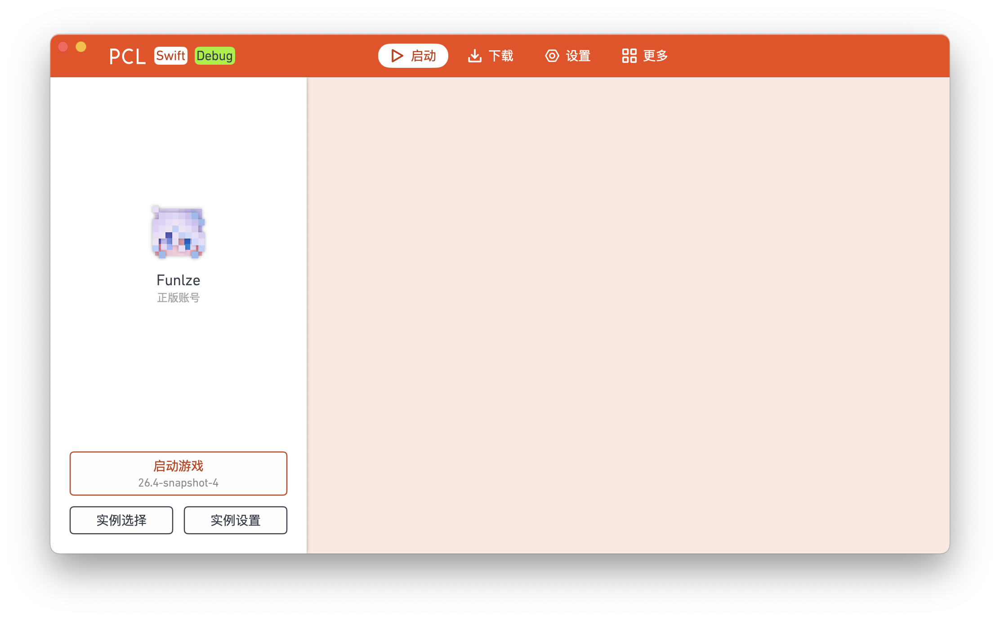
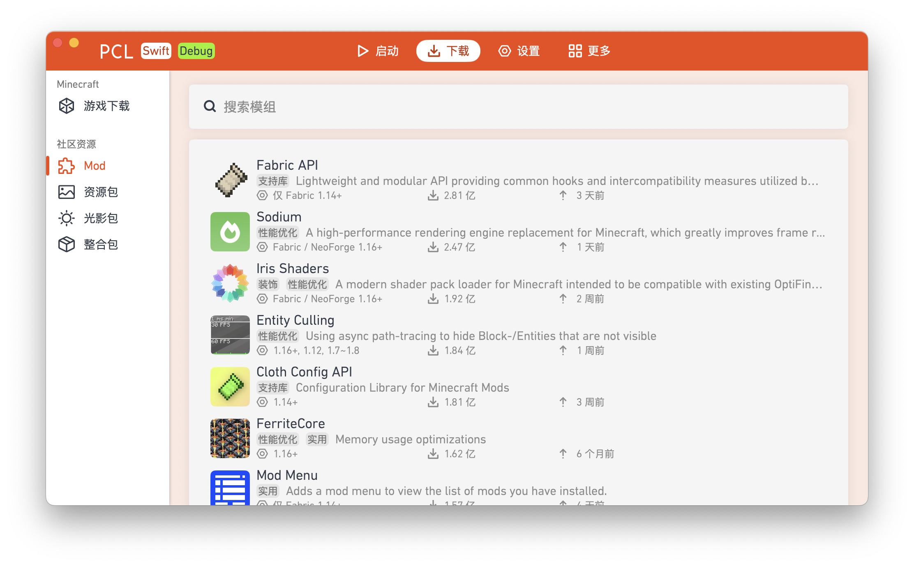

# PCL.Swift

  
  <h1>PCL.Swift</h1>
  
  
  
  

 

PCL.Swift 是 [Plain Craft Launcher](https://github.com/Meloong-Git/PCL)（由 [龙腾猫跃](https://afdian.com/a/LTCat) 制作的 Minecraft 启动器）的**非官方** macOS 重构版，使用 SwiftUI 框架**完全重构**了 PCL 以支持 macOS。

本项目基于 Cylorine Studio 的 [PCL.Mac.Refactor](https://github.com/CylorineStudio/PCL.Mac.Refactor) 1.1.1 独立维护，在其之上做了系统性的性能与结构改造。

<table>
  <tr>
    <td></td>
    <td></td>
  </tr>
</table>

问题反馈：请前往 [Issues](https://github.com/LakelightLily-Studio/PCL.Swift/issues)。

**请不要在 PCL 官方版本 / 其它版本相关仓库或群聊中反馈关于 PCL.Swift 的问题。**

## 相比 PCL.Mac.Refactor 改了什么

### 稳定性

- **启动器配置落盘去抖**：原先只在退出时写盘，崩溃或强退会丢掉本次会话的全部设置；现改为改动后 0.5 秒合并写盘、退出时再 flush。
- **版本清单与版本排序走显式 seam**：清单改为可注入，排序逻辑抽成独立函数，并补上对应测试——此前这段逻辑靠隐式解包取全局状态，出错只会在运行时炸。
- **清除死代码**：移除五处没有调用点的声明，并删掉只复述声明的文档注释。

### 结构

- **单例改为显式注入**：`JavaManager` / `DownloadSourceManager` / `ResourceCache` / `VersionManifest` / `FlagsManager` 全部走 `install(_:)` + `shared`，未注入时给出可定位的 `fatalError`，取代原先的 `!` 隐式解包——把一个随机崩溃点变成一行明确的错误信息。
- **错误处理分层**：公开 API 用 `throws(SomeError)` 收窄错误类型，就地失败用 `SimpleError`，`try?` 只留给确有降级路径的场景；全仓库不再有空 `catch {}`。
- **主线程调度统一**：新代码一律 `@MainActor`，只有并发标注够不着的回调边界才退回 `DispatchQueue.main.async`。
- **ATS 不再全局放行**：Debug 与 Release 都不再整包关闭 App Transport Security，改为只对必要的域名开例外。
- **CI 真正跑测试**：PR 与 `main` 的推送都会执行 `xcodebuild test`，此前工作流只构建不测试。
- **设置行与字节格式化去重**：抽成 `SettingRow` 与 `ByteFormat`，两处重复实现合并为一处。

### 新增功能

- **主题机制**：设置 → 个性化里可切换主题色，当前提供「主题橙」（默认）与「主题蓝」。强调色整套色阶（主色、深/浅档、选中背景、窗口底色）随主题联动，文字与灰阶保持不变以维持对比度。
- **正版账号皮肤头像**：Mojang 的纹理服务只返回 `http://` 地址，此前被 App Transport Security 拦下，导致正版账号一直显示默认皮肤；现按域名开例外，头像正常加载。

## 下载
你可以在 [Releases](https://github.com/LakelightLily-Studio/PCL.Swift/releases) 中下载 PCL.Swift（Universal）。

## 环境要求

|          |          最低           |    推荐     |
|:--------:|:-----------------------:|:-----------:|
| 普通使用 |       macOS 12.0        | macOS 14.0+ |
|   开发   | macOS 14.5 (Xcode 16) |      —      |

同时支持 Intel 与 Apple 芯片。

> 开发构建需要 **Swift 6.4** 工具链（源码使用了 6.1+ 的调用参数尾随逗号与 `withTaskGroup` 返回类型推断）。命令行下 `TOOLCHAINS` 与 `-toolchain` 均不生效，需覆盖 `SWIFT_EXEC`，详见 [AGENTS.md](AGENTS.md)。

## 许可证
- PCL.Swift 使用与 [PCL](https://github.com/Meloong-Git/PCL) 相同的许可证，并遵守其中关于"重度使用"的规定。
- PCL.Swift.Core（`PCL.Swift.Core/`）采用 MIT License 协议，使用其代码时请**保留许可证**及署名信息。
